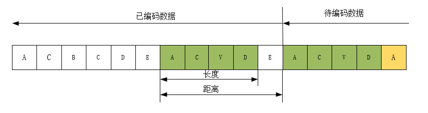

# GZIP

## 前言

压缩可以分为有损压缩和无损压缩两类，有损压缩和无损压缩两类。

## LZ77算法

### 算法原理

LZ77算法是基于字典的压缩算法，原始的LZ77算法和deflate算法里面使用的LZ77算法有很小的区别，首先来看一下原始的LZ77算法的实现过程

LZ77算法使用一个滑动窗口来不断的对数据进行搜索。LZ77算法的核心思想是在历史数据里面寻找重复的字符串，然后后面的数据就可以用这个重复的字符串来进行表示。

理论上来说搜索的范围越大，那么找到重复性元素的概率也越大，当然需要的缓存也越大。同时有一个在压缩算法中很常用的思想就是局部性原理，局部性原理就是说如果一个字符串要重复，那么他和他周边的字符串重复的概率要大于更远的字符串，所以这个时候就需要一个平衡了，我们可以设置一个搜索窗口，每次都只在这个搜索窗口里面进行字符串的搜索，来看是不是有重复的字符串。

LZ77算法的示意图如下所示：

在上图中左侧是已编码的数据，右侧是待编码的数据。

注意到ACVD四个元素和已编码区里面有重复的，距离distance=5，长度length=4。当这四个元素压缩完之后，就轮到字符A了，按道理说字符A在前面编码区里面有好几个重复的，但是这个并不值得我们去压缩它。

因为压缩后的数据需要用<distance, length>这样的二元组来表示，假定distance和length都是8bit的数据，那么这样一个二元组是16bit，这比原始数据还大，所以这种情况就不会进行压缩，在实际使用的时候只有重复元素大于等于3个才使用这种二元组的方式来表示。

此外还有一种情况就是代编码元素在已编码区真的没有和它所对应的元素存在，这种情况和上面不进行压缩的情况都被叫做literal，也就是保存原始数据的意思。

所以在LZ77算法里面就是通过以下两种方式来保存数据

- <distance, length>
- literal

比如上面的例子

| 步骤 | 位置 | 是否匹配 | 输出   |
| ---- | ---- | -------- | ------ |
| 1    | 1    | 否       | A      |
| 2    | 2    | 否       | C      |
| 3    | 3    | 否       | B      |
| 4    | 4    | 否       | C      |
| 5    | 5    | 否       | D      |
| 6    | 6    | 否       | E      |
| 7    | 7    | 否       | A      |
| 8    | 8    | 否       | C      |
| 9    | 9    | 否       | V      |
| 10   | 10   | 否       | D      |
| 11   | 11   | 否       | E      |
| 12   | 12   | 否       | A      |
| 13   | 13   | 否       | C      |
| 14   | 14   | 是       | <5, 3> |
| 15   | 15   | 是       | <5, 4> |
| 16   | 16   | 否       | A      |

所以上述压缩后的结果就是ACBCDEACVDE54A

### FPGA实现

FPGA实现中一个很困难的点是如何快速的在缓存单元里面找到匹配的字符串，这一部分将使用哈希算法来实现。

使用的哈希函数如下：

HASH<a, b, c> = (a << (HASH_BITS - 8)) ^ (a >> (HASH_BITS - 8) / 2) ^ a ^ (b<< (HASH_BITS - 8)) ^ (b>> (HASH_BITS - 8) / 2) ^ b ^ (c<< (HASH_BITS - 8)) ^ (c>> (HASH_BITS - 8) / 2) ^ c

其中HASH_BITS指的是HASH存储单元的地址大小，也就是缓存单元的大小，比如4k大小的缓存单元HASH_BITS就是12

实现步骤定义两个MEM，一个用于存储HASH的指针坐标，另一个MEM用来保存数据。

存储HASH指针坐标一方面用于记录distance，另一方面用于判断是不是进行压缩存储。

此外增加一个MEM用来标志两次BLOCK，比如第一个BLOCK用0，第二个用1，第三个用0，这样把每个BLOCK之间都区分开来。

